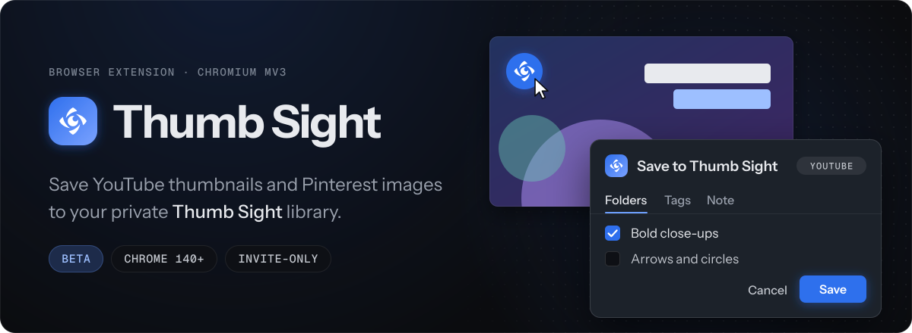
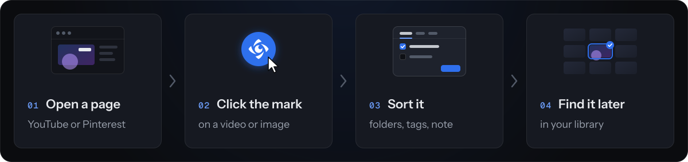

<p align="center">
  
</p>

Browser extension for [Thumb Sight](https://www.thumbsight.com), a private library for YouTube thumbnails and Pinterest references. It adds a save button to YouTube and Pinterest. Click it, pick folders, add tags or a note, and the image lands in your library.

It's in beta. Accounts are invite-only, and the extension isn't in the Chrome Web Store yet.

**[Download the latest release](https://github.com/quetzaone/thumbsight-extension/releases/latest)**

## Install

Chrome, Edge or Opera, version 140 or newer.

1. Download `ThumbSight-Public-Beta-<version>.zip` from the [latest release](https://github.com/quetzaone/thumbsight-extension/releases/latest). Not the "Source code" archives.
2. Unzip it to a folder you'll keep. The browser loads the extension from there.
3. Open `chrome://extensions`, turn on Developer mode, click **Load unpacked** and pick that folder.
4. Click the extension icon and sign in.

To update, unzip the new version into the same folder and click **Reload** on the extension card. Don't remove the extension first, or you'll have to sign in again.

## How it works

<p align="center">
  
</p>

On YouTube the button shows up on video pages, Shorts, live streams and video tiles, and on channel pages you can follow the channel. On Pinterest it appears when you hover over a pin.

You sign in on the Thumb Sight website, not in the extension. The extension talks only to the Thumb Sight backend and has no analytics. It asks for `storage` and `identity` and runs on youtube.com, pinterest.com and pinterest.ru.

## Browsers

- Chrome, Edge, Opera 140+: supported.
- Firefox: not yet. `manifest.firefox.json` is an unfinished port.
- Safari: there's an experimental unsigned build for macOS, see [docs/safari-unsigned.md](docs/safari-unsigned.md). It hasn't been tested on a Mac yet, and sign-in doesn't work there.

## Development

No build step, the repo is the extension. Tests need Node 20.15+.

```sh
npm ci --ignore-scripts
npm run test:public
```

To run it from source, copy `config.example.js` to `config.js` and put the public anon key in it, or take `config.js` from a release ZIP. See [DEVELOPMENT.md](DEVELOPMENT.md) for browser checks and packaging.

## Issues

Open an issue with the extension version (it's in the popup) and the error text. Please don't attach tokens, `config.js` or HAR files.

## License

MIT. Icon notices are in [THIRD_PARTY_NOTICES.md](THIRD_PARTY_NOTICES.md).
